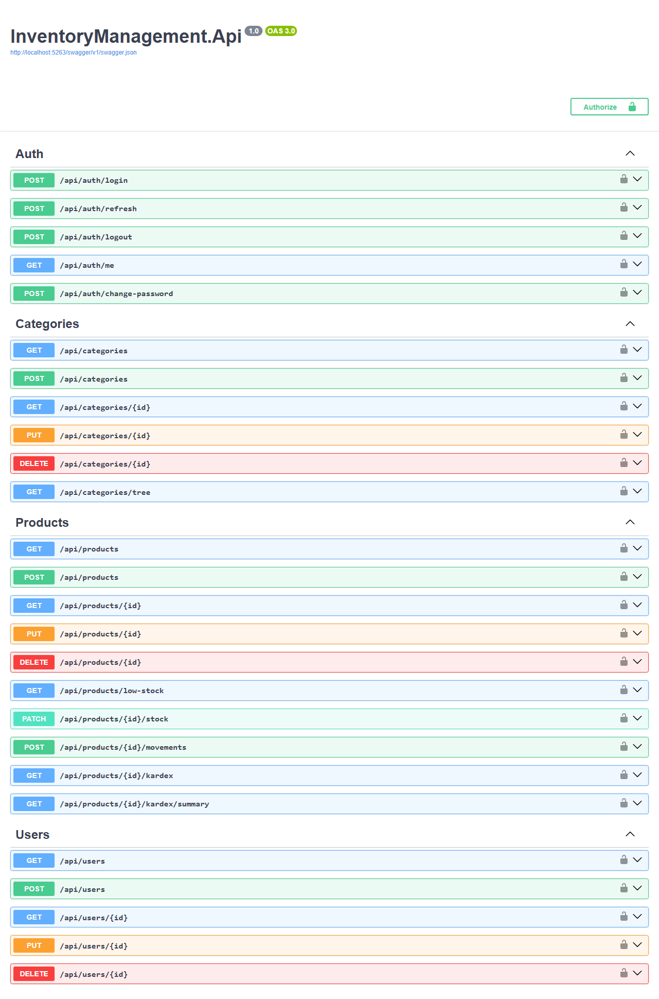
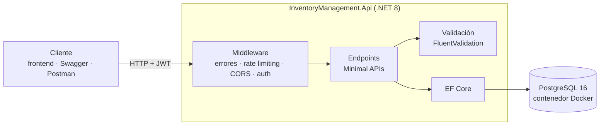

# InventoryManagement

> API REST de gestión de inventario para pymes: catálogo de productos, movimientos de stock con kardex valorizado y control de acceso según el rol de cada persona (Admin, Inventario, Contador, Comprador).



## Funcionalidades

- **Catálogo:** categorías jerárquicas (con vista de árbol) y productos, con búsqueda, filtros por precio y fecha, orden por varios campos y paginación.
- **Stock y kardex:** entradas, salidas y ajustes; historial de movimientos por producto y resumen valorizado. No permite una salida mayor al stock disponible.
- **Alertas:** listado de productos bajo su stock mínimo.
- **Autenticación:** JWT con refresh tokens que rotan en cada uso y se pueden revocar (logout, cambio de contraseña).
- **Roles y permisos:** 4 roles de negocio; cada endpoint exige el rol que corresponde.
- **Auditoría:** cada registro guarda quién lo creó y quién lo modificó; cada movimiento, quién lo registró.
- **Usuarios:** administración de usuarios con validación de RUT chileno.
- **Operación:** health checks, límite de peticiones por minuto, logs estructurados en JSON y errores en formato estándar (RFC 7807).

### Endpoints principales

| Recurso | Endpoints |
|---------|-----------|
| Auth | `POST /api/auth/login` · `refresh` · `logout` · `change-password` · `GET /api/auth/me` |
| Categorías | CRUD en `/api/categories` · `GET /api/categories/tree` |
| Productos | CRUD en `/api/products` · `GET /low-stock` · `PATCH /{id}/stock` |
| Kardex | `POST /api/products/{id}/movements` · `GET /{id}/kardex` · `GET /{id}/kardex/summary` |
| Usuarios | CRUD en `/api/users` (solo Admin) |
| Salud | `GET /health` · `/health/ready` · `/health/live` |

La documentación completa, con ejemplos, está en Swagger.

## Stack

| Capa | Tecnología |
|------|------------|
| Backend | C# · ASP.NET Core 8 (Minimal APIs) |
| Frontend | React 19 · TypeScript · Vite · React Router |
| Base de datos | PostgreSQL 16 · Entity Framework Core 8 |
| Validación y mapeo | FluentValidation · Mapster |
| Seguridad | JWT Bearer · BCrypt · rate limiting nativo de .NET |
| Observabilidad | Serilog · Health Checks |
| Documentación | Swagger / OpenAPI (Swashbuckle) |
| Tests | xUnit · FluentAssertions · Testcontainers |
| Infraestructura | Docker · Docker Compose |

## Cómo ejecutarlo

Requisitos: [Docker](https://www.docker.com/) y, para la opción A, el [SDK de .NET 8](https://dotnet.microsoft.com/download/dotnet/8.0).

```bash
git clone https://github.com/DHat3r/InventoryManagement.git
cd InventoryManagement
cp .env.example .env
```

### Opción A: base en Docker, API local (recomendada para desarrollar)

```bash
docker compose up -d
cd InventoryManagement.Api
dotnet run
```

Swagger queda en `http://localhost:5263/swagger`. Al arrancar en modo Development, la API aplica las migraciones y crea el usuario administrador (configurado en `AdminSeed` de `appsettings.Development.json`).

### Opción B: todo en Docker

En `.env`, cambia `ASPNETCORE_ENVIRONMENT` a `Development` (en `Production` Swagger está desactivado y las migraciones no se aplican solas). Luego:

```bash
docker compose --profile api up -d --build
```

La API queda en `http://localhost:5263` y el usuario administrador se crea con las variables `ADMIN_*` de `.env`.

> Antes de usarlo fuera de tu máquina, cambia `JWT_SECRET`, `POSTGRES_PASSWORD` y `ADMIN_PASSWORD` en `.env`.

### Frontend (panel web)

Con la API corriendo en `http://localhost:5263` (opción A o B), en otra terminal:

```bash
cd frontend
npm install
npm run dev
```

El panel queda en `http://localhost:5173`: login, listado de productos con búsqueda y filtro de stock bajo, y kardex de cada producto con registro de movimientos. En desarrollo, Vite reenvía las peticiones `/api` a la API (proxy), así que no hace falta configurar CORS.

> Vite no funciona si la ruta de la carpeta contiene `#` (por ejemplo `c#/`). En ese caso usa `npm run build` y `npm run preview` (puerto 4173), o clona el repo en una ruta sin `#`.

## Tests

```bash
cd InventoryManagement.Tests
dotnet test
```

Requiere Docker en ejecución. Hay 35 tests:

- **15 unitarios** de los validadores (FluentValidation sobre EF Core InMemory).
- **20 de integración** que levantan la API completa contra un PostgreSQL real en un contenedor (Testcontainers): auth, categorías, productos y movimientos de stock.

## Arquitectura

La API es el único punto de acceso a los datos: cualquier cliente (el panel React de `frontend/`, Swagger o Postman) se comunica con ella por HTTP, y ella es la única que habla con la base de datos.



Cada petición pasa por estas capas:

1. **Middleware:** captura errores y los devuelve en formato estándar (ProblemDetails), limita las peticiones por minuto y valida el token JWT.
2. **Endpoints:** comprueban que el rol del usuario tenga permiso, reciben DTOs (nunca las entidades directamente) y aplican las reglas de negocio, por ejemplo rechazar una salida si no hay stock suficiente.
3. **Validación:** revisa los datos antes de tocar la base (formato, SKU único, que la categoría exista).
4. **EF Core:** traduce las operaciones a SQL. Un movimiento de stock y la actualización del inventario se guardan en una misma transacción, para que el kardex nunca quede descuadrado.

En desarrollo, PostgreSQL corre en Docker y la API con `dotnet run`; con `docker-compose --profile api` ambos corren en contenedores.

## Decisiones técnicas

- **Minimal APIs y no controladores:** menos código repetitivo y es el estilo moderno de .NET. La contra es que todo quedó en `Program.cs`, que hay que separar por módulos (ver abajo).
- **JWT propio y no ASP.NET Identity:** el modelo de usuario necesita RUT y roles de negocio propios, e Identity trae muchas tablas y flujos que no se usan. Hacerlo a mano también deja claro cómo funciona cada paso.
- **Refresh tokens guardados como hash (SHA-256):** si alguien leyera la base de datos, no podría usar los tokens. Cada refresh invalida el token anterior.
- **Testcontainers y no InMemory para integración:** InMemory no se comporta como PostgreSQL (transacciones, índices únicos, claves foráneas). Probar contra la base real evita falsos positivos.
- **Cantidad siempre positiva en los movimientos:** el tipo (entrada, salida, ajuste) define el signo, como en contabilidad. Así los reportes no dependen de interpretar números negativos.
- **DTOs separados de las entidades:** la API no expone el modelo de la base, y cambiarlo no rompe a los clientes.
- **Errores en formato ProblemDetails (RFC 7807):** todos los errores tienen la misma forma y un identificador de correlación, lo que facilita manejarlos en un frontend y rastrearlos en los logs.

## Qué mejoraría con más tiempo

- **CI con GitHub Actions:** build, tests y reporte de cobertura en cada pull request.
- **Separar `Program.cs`** (más de 1000 líneas) en un archivo de endpoints por módulo.
- **Migraciones en producción:** hoy solo se aplican solas en Development; falta un paso de migración explícito para el despliegue.
- **Secretos sin valores por defecto** en `docker-compose.yml`, para que la API no arranque con un `JWT_SECRET` conocido.
- **Más tests:** servicios (auth, movimientos) y endpoints de usuarios.
- **Mensajes de validación de movimientos:** las reglas de negocio del validador responden con un mensaje genérico ("Validación de negocio fallida") en vez del motivo concreto, como stock insuficiente.
- **Frontend:** contenedor propio (nginx) en `docker-compose`, tests de componentes y pantallas de categorías y usuarios.
- **Siguiente etapa:** caché con Redis, módulos de proveedores y pedidos y despliegue público con Swagger visible.

## Autor

Leandro · [GitHub](https://github.com/DHat3r)
